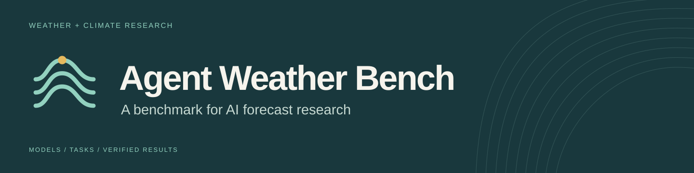
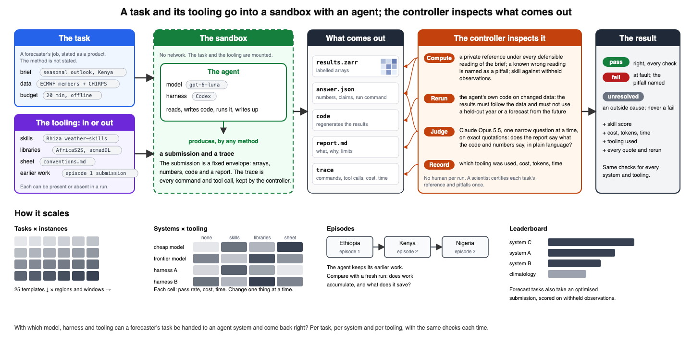

# Agent Weather Bench

## Which frontier models and agent frameworks can reliably complete substantive weather-forecasting workflows, with what scientific validity, cost, time, and expert intervention?

Agent Weather Bench assesses complete scientific workflows for subseasonal-to-seasonal (S2S) weather and climate forecasting: acquiring and interpreting data, investigating teleconnections and methods, writing and adapting scientific code, downscaling and calibrating, producing operational forecasts, auditing research claims, and verifying results. 

The benchmark draws on scientific reproduction and research benchmarks such as [PaperBench](https://openai.com/index/paperbench/), [SciReplicate-Bench](https://arxiv.org/abs/2504.00255), and [RE-Bench / AIRS](docs/hard-benchmark-inspiration-2026-10-08.md). It uses forecasting research to test whether autonomous agents can implement scientific methods, run valid experiments, and support their conclusions with empirical evidence.

For AI and machine learning researchers, the benchmark provides standardized templates and rigorous checks to compare models, agent harnesses, and tooling environments (plain scientific Python vs. domain packages like `AfricaS2S`, `acmadDL`, and Rhiza). It measures whether the work was done right, its scientific correctness, cost, wall-clock time, and tool efficiency.

For operational forecasters, the goal is to provide evidence for when and how AI agents can be trusted with substantive forecasting work: what workflows agents complete reliably, where they break down, and where human expert review is required.

[The Six Primitives](#the-six-primitives-of-the-benchmark) · [The 25-Task Portfolio](#the-full-iceberg-the-25-task-portfolio) · [Current Frontier: Finding the Difficulty Boundary](#the-current-frontier-finding-the-difficulty-boundary) · [Run a Template](#run-a-template) · [Results](docs/results.md) · [Roadmap](docs/roadmap.md)

---

## The Six Primitives of the Benchmark

The benchmark is built on six explicit, modular primitives:



1. **Template & Instance**
   * A **Template** is a parameterized forecasting task defining the problem brief, frozen source data catalogues, and the verification specification (`spec.yaml`).
   * An **Instance** fixes the parameters for a concrete scenario (e.g. Greater Horn of Africa, March–May season, initialized in February).
   * An **Attempt** is a single run of one agent system on one instance.

2. **System**
   * A **System** (`systems/<name>/system.yaml`) bundles four elements:
     * **Model Backbone:** The foundation LLM (e.g. Claude 3.7 / Sonnet, GPT-4o, Codex).
     * **Agent Harness:** The CLI execution engine (Codex CLI, Claude Code, custom scaffold).
     * **Tooling Condition:** The environment exposed to the agent (standard scientific Python, Rhiza weather skills, or domain libraries like `AfricaS2S`, `acmadDL`, and `rosetta`).
     * **Resource Budget:** Hard bounds on wall-clock time, tool calls, and inference tokens.

3. **Sandbox & Controller**
   * The **Controller** (`assessment/`) is the trusted outside evaluator.
   * The agent runs in an isolated, offline Docker **Sandbox** with only allowed input directories or frozen source services mounted.
   * Private reference implementations, withheld verification observations, and ground truth arrays remain strictly outside the sandbox. The controller logs every tool call, shell command, and file modification as an immutable trace.

4. **Submission Envelope**
   * When an attempt finishes, the agent must leave behind a standard submission envelope under `/work/submission/`:
     * `results.zarr`: Labelled multi-dimensional arrays (NetCDF/Zarr) storing predicted fields, diagnostics, and probabilities.
     * `answer.json`: Structured claims, coordinate definitions, metadata, and the exact reproduction command.
     * `code/`: Self-contained executable scripts that regenerate all results from scratch.
     * `report.md`: A structured meteorological bulletin, scientific account, or diagnostic audit.

5. **Instruments & Rubric**
   * Submissions are graded by a declared set of method-blind **Instruments**:
     * **Reference Match:** Compares numerical arrays against a private reference function within explicit floating-point error bounds, identifying which accepted reading or named pitfall the agent followed.
     * **Invariants:** Physical and mathematical sanity checks that any valid forecast must satisfy (e.g. probabilities sum to 1.0, non-negative rainfall, conservation of spatial mass).
     * **Probes:** The controller reruns the agent's code on perturbed data, replayed inputs, or with held-out years removed to detect data leakage, lookahead bias, or hardcoded numbers.
     * **Claims Verification:** Automatically verifies that numeric assertions in `answer.json` match the underlying arrays.
     * **Prose Judge:** Narrow, single-question evaluation of specific quoted text from `report.md` via a pinned Claude Opus reviewer.
   * Every check returns **pass**, **fail**, or **unresolved**, with concrete evidence.

6. **Certification**
   * Before any model attempt is counted, every task template must pass a strict five-step automated certification:
     1. Independent reference implementations agree.
     2. Known-correct controls pass all checks.
     3. Deliberately perturbed/faulty controls fail on the exact intended check and nowhere else.
     4. Named pitfalls are cleanly separable.
     5. Grader numerical tolerances and error bounds are mathematically derived and proven.

---

## The Full Iceberg: The 25-Task Portfolio

The benchmark spans 25 canonical tasks across six distinct forecasting families:

| # | Template | Family | Mode | Level 2 | Distinct Challenge | Status |
| --- | --- | --- | --- | --- | --- | --- |
| 1 | Diagnostic pack | Downscaling and diagnostics | product | no | Spatial patterns, verification metrics | reference written |
| 2 | Kenya rainfall outlook | Outlook products | product | no | Regional aggregations, threshold masks | reference written |
| 3 | Kenya heat outlook | Outlook products | product | no | Temperature extremes, heat index | reference written |
| 4 | `kenya-forecast-revision` | Outlook products | product | no | Accumulations, valid periods, regional means and claims | **certified** |
| 5 | Observed Indian Ocean Dipole index | Observed indices and verification | product | no | DMI SST dipole calculation, detrending | reference written |
| 6 | Indian Ocean Dipole forecast check | Outlook products | product | no | Teleconnection lag, ensemble plume checks | reference written |
| 7 | Scorecard debugging | Observed indices and verification | product | no | Verification metrics, ROC / Brier scores | reference written |
| 8 | Station verification | Observed indices and verification | product | later | Station-to-grid matching, missing data | reference written |
| 9 | Paper-versus-code audit | Observed indices and verification | product | no | Discrepancy detection between paper & code | reference written |
| 10 | Probability forecast combination | Seasonal forecast production | process | later | Multi-model weighting, probability consensus | reference written |
| 11 | `seasonal-rainfall-calibration` | Seasonal forecast production | process | yes | Cross-validation and required scientific practice | **certified** |
| 12 | Short-rains workflow | Seasonal forecast production | process | yes | East Africa OND season, SST teleconnections | reference written |
| 13 | Seasonal CCA reproduction | Seasonal forecast production | process | yes | Nested selection, probabilistic forecasts | reference written |
| 14 | Monthly cyclic calibration | Seasonal forecast production | process | yes | Harmonic regression, cycle decomposition | reference written |
| 15 | `weeks34-rainfall` | Subseasonal forecast production | outcome | yes | Leakage, reproducibility, withheld-observation skill | **certified** |
| 16 | Rainfall downscaling | Downscaling and diagnostics | product | yes | Spatial conservation, held-out years | reference written |
| 17 | Rainy-season onset and dry spells | Subseasonal forecast production | process | yes | Daily rainfall thresholds, false onset checks | to build |
| 18 | Probabilistic forecast verification | Observed indices and verification | process | no | Reliability diagrams, RPSS, spread-error | to build |
| 19 | Multi-model combination with hindcasts | Seasonal forecast production | process | yes | Hindcast calibration, unequal model weights | to build |
| 20 | Test a published predictor claim | Research claims and consensus | process | yes | Re-evaluating published teleconnections | to build |
| 21 | Beat the regional consensus forecast | Research claims and consensus | process | yes; hard | Competitive skill against regional GHACOF | to build |
| 22 | Probabilistic weeks 3–4 and 5–6 outlook | Subseasonal forecast production | process | yes | S2S multi-week lagged ensemble outlook | to build |
| 23 | Weekly forecasting with observation updates | Subseasonal forecast production | outcome | yes; hard | Sequential real-time assimilation updates | to build |
| 24 | Madden–Julian Oscillation forecast check | Outlook products | product | no | RMM index calculation, phase propagation | to build |
| 25 | Extreme-event probability at weeks 2–3 | Outlook products | product | yes | Tail probability, rare-event calibration | to build |

See [docs/task-set.md](docs/task-set.md) for detailed task definitions, parameter sweeps, and grading criteria.

---

## The Current Frontier: Finding the Difficulty Boundary

We are currently probing the **tip of the iceberg**: establishing where modern agent systems actually encounter difficulty.

### What the Initial Pilot Found
In our first round of trials on single-stage templates (like `seasonal-cca-reproduction`, `rainfall-downscaling`, and `monthly-cycle-calibration`):
* **Single-stage tasks saturated immediately:** Frontier models (Claude 3.7 / Astra, GPT-4o / Luna) completed them in **2 to 5 minutes** with 100% mathematical precision.
* **Prescribed methods became transcription jobs:** Because single-stage reference matching required explicit equations in the brief, the tasks tested code transcription rather than scientific reasoning or workflow autonomy.
* **Unconstrained methods hit science ceilings:** When tasks left method selection open (e.g. `mam-forecast-synthesis`), simple uniform climatology beat or tied all models on blind verification. With zero skill headroom, the tasks could not grade forecaster competence.
* **Tooling showed no measured benefit:** Providing specialized libraries (`AfricaS2S`, `acmadDL`) yielded no advantage over raw NumPy/SciPy written by the model from scratch.

### The Next Step: Long-Horizon Composition

To measure real agent autonomy, planning, and error recovery, we are building a **long-horizon composition task**: chaining the canonical stages of a regional operational center into one continuous multi-hour job.

Anchored in the operational workflow of **ICPAC** (IGAD Climate Prediction and Applications Centre) for the GHACOF seasonal outlook (`from_icpac/ghacof/frameworks/`):
```text
Raw Provider Sources (NMME / C3S / CHIRPS / SST)
  │
  ├─► Stage 1: Acquire (Raw provider response ingestion via frozen catalogues)
  ├─► Stage 2: Prepare (Seasonal totals, coordinate alignment, tercile climatology)
  │
  ├── Multi-Stream Modeling:
  │     ├─► Stage 3: WVG Logit Stream (SST index logistic regression)
  │     ├─► Stage 4: eReg Stream (Per-cell cross-validated ensemble regression)
  │     └─► Stage 5: CCA Stream (PyCPT-style Canonical Correlation Analysis)
  │
  ├─► Stage 6: Combine (Equal-weight multi-stream probability consolidation)
  ├─► Stage 7: Verify (Hindcast skill verification against historical observations)
  └─► Stage 8: Issue & Write (Forecast-season outlook arrays and the official bulletin)
```

### The Rubric Innovation: Dual Verdicts (Absolute vs. Local)

In a traditional single-gate benchmark, an early minor calculation error in Stage 2 cascades into Stages 3–8, failing the entire attempt and obscuring whether the agent was capable of complex downstream modeling.

The composition task introduces **per-stage rubrics with dual verdicts**:
* **Absolute Verdict:** Compares the stage's output against the reference solution generated from ground-truth upstream inputs.
* **Local Verdict:** Recomputes the reference using the *agent's own upstream outputs* as inputs.

This separates initial slips from downstream procedural competence, revealing exactly at which stage a system went wrong and how well it executed the subsequent workflow.

---

## Run a Template

Use Python 3.12 or later and Docker. Agent commands execute exclusively inside the isolated Docker sandbox, keeping references and test secrets protected on the host.

```sh
# Setup environment
python3 -m venv .venv
source .venv/bin/activate
pip install -e '.[dev]'

# Inspect a task's full contract and rubric
python -m assessment rubric kenya-forecast-revision

# Verify that the known-correct reference control passes all checks
python -m assessment assess kenya-forecast-revision service-area--weeks-1-2 --control correct

# Run an agent system on a task instance
python -m assessment run kenya-forecast-revision service-area--weeks-1-2 --system codex-astra
```

Common evaluation workflows:
- `rubric <template>`: Prints the full contract table: questions, instruments, evidence sources, and gating rules.
- `assess <template> <instance> <path>`: Evaluates a completed submission directory against the rubric.
- `run <template> <instance> --system <sys>`: Executes a full attempt in the Docker sandbox and triggers the controller evaluation.
- `certify <template>`: Runs the 5-step automated certification suite on a template.

---

## Repository Layout

- `assessment/` — The trusted controller: sandbox management, adapters, instrument checks, LLM judging, and rubric compilation.
- `templates/` — The implemented forecasting templates, each containing `spec.yaml`, `brief.md`, `reference.py`, test controls, and `certification.json`.
- `standards/` — Published institutional standards cited by process-mode templates.
- `systems/` — System definitions: model backbone, harness CLI, tooling image, and resource budget.
- `runtime/` — Docker configurations for the isolated execution sandboxes and tooling environments.
- `from_icpac/` — Canonical operational GHACOF reference pipelines and multi-framework comparison scripts.
- `docs/` — Architectural contracts, historical trial results, and roadmap:
  - [`docs/roadmap.md`](docs/roadmap.md): The phased execution sequence for the composition task.
  - [`docs/assessment-format.md`](docs/assessment-format.md): Specification of the submission envelope and grading rubric.
  - [`docs/task-set.md`](docs/task-set.md): The full portfolio of 25 candidate forecasting tasks.
  - [`docs/results.md`](docs/results.md): Summary of assessed attempts and diagnostic findings.
- `tests/` — Grader test suite and certification invariants.
- `var/` — Local runs, staged datasets, and private instances (git-ignored).
- `archive/` — Early evaluators and superseded prototypes, preserved intact.
